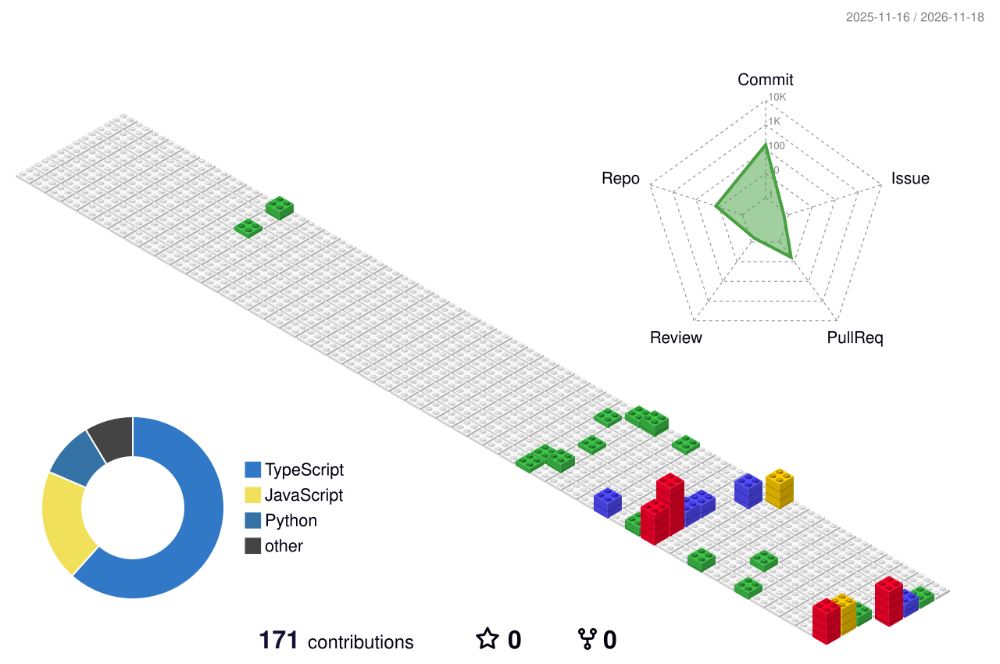

# ⚡ BISWADEEP CHAKRABORTY
### Systems & ML/DL Engineer • Neurocognition Researcher

<!-- Minimal Fira Code Tagline -->

  
  
  

---

<!-- Reskinned Minimal Neuroscience + Tetris Synaptic Lattice Widget -->

  

---

## 🧬 About Me

I work between **Low-Level Systems Engineering, Neurotechnology, and Neurocognition**, driven by a foundational question: ***understanding how biological cognitive systems understand***.

My primary research niche and major focus lie in **Systems, Neurotech & Neurocognition**. I am fascinated by the mechanics of biological information routing, synaptic memory formation, and the dynamical principles that govern cognitive emergence. While engineering a **continuous-time synapse prediction system for the *Caenorhabditis elegans* (*C. elegans*) connectome** to model cognitive and sensorimotor neural signaling, I encountered a critical architectural roadblock: conventional graph neural networks (GNNs) and recurrent models suffered from catastrophic memory overhead and temporal aliasing when attempting to track continuous-time spike intervals and synaptic plasticity without unrolling entire graphs into memory. To overcome this, I formulated **RT-GNN (Time-Parameter for GNNs)**—introducing continuous-time complex rotation semigroups that model biological synaptic decay and cognitive state transitions in closed form.

My technical foundations unite computational neurocognition with high-performance systems engineering:
- **Neurocognition & Biological Intelligence**: Investigating the computational foundations of cognition, synaptic connectivity prediction (*C. elegans* connectome), continuous-time neural signaling, and biological temporal dynamics.
- **Continuous-Time Neural AI (RT-GNN)**: Formulating continuous-time state-space representations and parallel associative prefix scans that model continuous cognitive and graph dynamics with strict memory bounds.
- **Memory-Bounded Systems & Pathfinding (CVRS)**: Designing sortingless spatial search architectures in **C** and **Unreal Engine 5** that eliminate priority-queue bottlenecks in multi-agent autonomous simulation.

I program primarily in **Python** (primary major language: PyTorch, PyG, ML & neurotech modeling) and **C** (next major language: low-level memory management, cache-conscious data layouts), backed by working knowledge of **Java**, **JavaScript**, **SQL**, and **Unreal Engine Visual Scripting (Blueprints)**. Prior to implementation, I actively use collaborative design tools like **Figma and Miro** to map out systems architecture, state transitions, and neural event lifecycles.

### Research & Engineering Focus
- **Neurocognition & Biological Intelligence** — Synapse prediction systems (*C. elegans* connectome), cognitive neural signaling, continuous-time synaptic plasticity, and investigating how biological neural networks produce cognitive understanding.
- **Continuous-Time Graph AI & Dynamics (RT-GNN)** — Closed-form complex rotation semigroups and logarithmic parallel associative prefix scans solving continuous synaptic dynamics without memory explosion.
- **Memory-Bounded Systems & Pathfinding (CVRS)** — Sortingless spatial search architectures and custom data structures that prevent algorithmic memory explosion in multi-agent navigation.
- **Low-Level Systems & Memory Optimization** — High-efficiency C architectures with cache-conscious layouts (DOD) eliminating tick-budget and latency bottlenecks.
- **Machine Learning & Time-Series Modeling** — GNNs, CNNs, ANNs, ARIMA forecasting, Decision Trees, Random Forests, Clustering, and KNN for cognitive, relational, and temporal datasets.
- **Simulation & Game Engine Systems** — Architectural experience with Unreal Engine, spatial navigation, tick budgets, and visual scripting.

---

## 🛠️ Technical Stack

### Primary Languages
- **Python** *(Major / Primary)* — Neurotech & cognitive modeling (PyTorch, PyG), continuous-time graph models, statistical pipelines
- **C** *(Next Major / Low-Level Systems)* — Low-level memory management, high-performance algorithm implementation (CVRS), spatial data structures
- **Java** — Object-oriented architecture, backend services, enterprise application structure
- **JavaScript** — Full-stack web platforms, client-side dynamics, API routing
- **SQL** — Relational database modeling, query optimization, analytics persistence
- **Unreal Engine Visual Scripting (Blueprints)** — Real-time gameplay logic, event dispatchers, simulation mechanics

### Machine Learning, Neurocognition & Mathematics
- **Neurocognition & Deep Learning:** Continuous-Time Graph Neural Networks (RT-GNN), Synaptic Connectivity Modeling (*C. elegans* Connectome), Cognitive Dynamics, Convolutional Neural Networks (CNNs), Artificial Neural Networks (ANNs), Continuous-Time SSMs
- **Classical ML & Statistics:** Linear/Logistic Regression, Decision Trees, Random Forests, K-Nearest Neighbors (KNN), K-Means Clustering, Hierarchical Clustering
- **Time-Series & Forecasting:** ARIMA, Multi-Harmonic Fourier Encodings, Autoregressive Dynamics
- **Frameworks & Libraries:** `PyTorch`, `PyTorch Geometric (PyG)`, `NumPy`, `SciPy`, `pandas`, `Scikit-Learn`

### Systems, Design & Collaboration
- **Supporting Languages:** `C++`
- **Design & Prototyping:** `Figma`, `Miro`, `Canva`, `System Architecture Diagramming`, `UI/UX Wireframing`
- **Infrastructure & Workflow:** Git, Linux / Windows, Docker, Agile / Sprint Planning.

---

## 🏆 Co-Flagship Research Projects

### 🧠 1. [Time-Parameter for Graph Neural Networks (RT-GNN)](https://github.com/BiswadeepInfinity/Time-Parameter-for-GNN)
> *Born from C. elegans synapse prediction: Resolving the continuous-time memory bottleneck in neural dynamics.*

- **The Neurocognition Origin**: Conceived while building a synapse prediction system for *C. elegans*. Existing models could not capture continuous-time spike intervals and synaptic plasticity without unrolling entire graphs into memory.
- **Closed-Form Continuous-Time Rotation**: Bypasses recursive neighborhood traversals via complex state operators $T_{\Delta t}(z) = z \cdot \exp((-\lambda + i\omega)\Delta t)$, maintaining the semigroup property $T(a) \circ T(b) = T(a+b)$.
- **Logarithmic Parallel Prefix Scans**: Replaces sequential Backpropagation Through Time (BPTT), cutting memory and time scaling from $O(K)$ down to $O(\log K)$ via associative prefix scans.
- **Benchmark Performance**: Outperformed recurrent baselines (TGN, DyRep) processing over **19,300+ edges/sec** on CPU while scoring **0.475+ Test MRR** on Stanford/TGB Wikipedia benchmarks.
- **Mathematical Invariant Verification**: Wrote an automated testing suite of **35 test gates** certifying causality, contractive norm decay, and autograd gradient preservation.

---

### 🗺️ 2. Clustered Vertex Representative Search (CVRS)
> *High-performance spatial pathfinding architecture engineered to eliminate the memory barrier in multi-agent autonomous navigation and real-time game simulation.*

Traditional shortest-path algorithms (like Dijkstra, A*, and hierarchical variants) rely heavily on priority queues (min-heaps). In multi-agent autonomous navigation—such as hundreds of agents pathfinding concurrently in Unreal Engine or robotic fleet simulation—managing sorting states for every agent creates an **exponential memory footprint**, severe cache misses, and frame-time spikes.

- **Bypassing the Sorting Barrier**: Inspired by Ran Duan et al.'s breakthrough research on sortingless shortest-path algorithms, CVRS avoids globally sorting candidate vertices in a priority queue during path traversal.
- **Hierarchical Clustered Representatives**: Partitions dense continuous or topological spatial graphs into clustered representative vertices, bounding the active search space to local sub-graphs and representative transitions.
- **Strict Memory Bounding**: Implemented in **C** for maximum cache locality and minimal memory overhead, preventing algorithmic memory explosion when scaling to thousands of concurrent autonomous searches.
- **Game Engine & AI Integration**: Designed for direct integration with **Unreal Engine 5** navigation meshes and reinforcement learning (RL) agent planners.

---

## 🚀 Featured Engineering Systems

### ⛈️ [Weather Intelligence as a Service (WIaaS)](https://github.com/BiswadeepInfinity/-Weather-Intelligence-as-a-Service-WIaaS-)
> *High-performance data ingestion pipeline feeding streaming weather data into planetary AI models.*

- **Predictive Risk Modeling**: Ingests real-time meteorological feeds to forecast power grid failures, crop hazards, and logistics risks using GraphCast deep learning architecture.
- **High-Throughput Streaming Ingestion**: Engineered an asynchronous data movement layer feeding global geospatial grids directly into hardware-accelerated model inference pipelines.

---

### 🍿 [Infinity Socials](https://github.com/BiswadeepInfinity/Infinity-Socials)
> *Full-stack review, rating, and socialization web platform.*

- **Collaborative Systems Design**: Prototyped user journey flows, wireframes, and relational schemas in Figma and Miro prior to implementation.
- **Full-Stack Architecture**: Built a complete web application with authentication, session lifecycles, and relational database schema in SQL for user interaction and rating graphs.

---

## 📈 Activity & Contribution Matrix

### 🧱 Neon Block Analytics & Contribution Grid
<picture>
  
</picture>

  

### 🎮 Contribution Activity Snake
<picture>
  <source media="(prefers-color-scheme: dark)" srcset="https://raw.githubusercontent.com/BiswadeepInfinity/BiswadeepInfinity/main/dist/github-contribution-grid-snake-dark.svg">
  <source media="(prefers-color-scheme: light)" srcset="https://raw.githubusercontent.com/BiswadeepInfinity/BiswadeepInfinity/main/dist/github-contribution-grid-snake.svg">
  
</picture>

  

### 🧊 3D Isometric Contribution Graph
<picture>
  <source media="(prefers-color-scheme: dark)" srcset="https://raw.githubusercontent.com/BiswadeepInfinity/BiswadeepInfinity/main/profile-3d-contrib/profile-night-rainbow.svg">
  <source media="(prefers-color-scheme: light)" srcset="https://raw.githubusercontent.com/BiswadeepInfinity/BiswadeepInfinity/main/profile-3d-contrib/profile-green-animate.svg">
  
</picture>

---

## 📊 Analytics & Coding Stats

### ⚡ Activity Trend

 

### 🎯 Development Profile & Commit Cadence

 

### 🔥 Streak & Repository Summary

---

  Systems &amp; Neurotech Engineer • Investigating computational neurocognition and biological intelligence through first-principles systems design.

