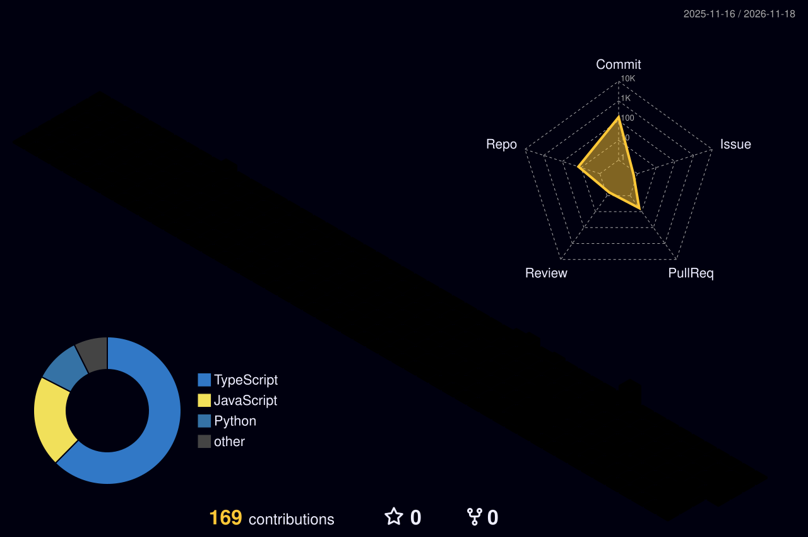

# ⚡ BISWADEEP (BiswadeepInfinity)

  
  
  

---

## 🧩 About Me

I am a **System Designer and Machine Learning Research Engineer** working at the intersection of deep learning theory, mathematical modeling, and low-latency systems architecture.

My technical foundation began in **Unreal Engine game development** programming in **C** and **Visual Scripting (Blueprints)**, where computational efficiency, cache coherence, and hardware resource boundaries determine viability. As I expanded into artificial intelligence and research, this systems background gave me a distinct edge: while conventional ML often treats hardware and memory as infinite resources, I architect models from a first-principles systems perspective.

I bridge mathematical AI foundations—spanning **Graph Neural Networks (GNNs), CNNs, ANNs, and statistical learning (ARIMA, ensemble methods, clustering)**—with low-level systems engineering in **Python** and **C** to build high-throughput, memory-bounded, production-ready machine learning solutions.

I also leverage collaborative design tools like **Figma and Miro** to map out system architectures, mathematical flows, and data lifecycles with cross-functional teams prior to implementation.

### Research & Engineering Focus
- **Graph Neural Networks & Temporal Modeling** — Formulating continuous-time state-space models (SSMs), closed-form complex rotation operators, and parallel associative prefix scans that eliminate redundant graph traversals.
- **Deep Learning Architectures** — Developing and tuning GNNs, CNNs, and ANNs for structured, spatial, and relational datasets.
- **Classical & Statistical ML** — Applying Linear/Logistic Regression, Random Forests, Decision Trees, KNN, K-Means Clustering, and ARIMA time-series forecasting.
- **Memory-Bounded Systems & Pathfinding** — Designing sortingless spatial search architectures (CVRS) and custom data structures that prevent algorithmic memory explosion.
- **Real-Time AI Telemetry Pipelines** — Building ultra-fast data ingestion pipelines feeding streaming datasets into planetary-scale AI models (GraphCast architectures).

---

## 🛠️ Technical Stack

### Primary Languages
- **Python** — Deep learning (PyTorch, PyG), scientific computing, statistical modeling, data pipelines
- **C** — Low-level memory management, high-performance algorithm implementation, systems design
- **Java** — Object-oriented systems, backend infrastructure, enterprise application architecture
- **JavaScript** — Full-stack web platforms, client-side dynamics, API routing
- **SQL** — Relational database modeling, query optimization, analytics pipelines
- **Unreal Engine Visual Scripting (Blueprints)** — Real-time event flows, interactive logic, simulation mechanics

### Machine Learning, Deep Learning & Mathematics
- **Deep Learning:** Graph Neural Networks (GNNs), Convolutional Neural Networks (CNNs), Artificial Neural Networks (ANNs), Continuous-Time SSMs
- **Classical Machine Learning:** Linear Regression, Logistic Regression, Decision Trees, Random Forests, K-Nearest Neighbors (KNN), Clustering (K-Means, Hierarchical)
- **Time-Series & Forecasting:** ARIMA, Multi-Harmonic Fourier Encodings, Autoregressive Dynamics
- **Frameworks & Libraries:** `PyTorch`, `PyTorch Geometric (PyG)`, `NumPy`, `SciPy`, `pandas`, `Scikit-Learn`

### Systems, Design & Collaboration
- **Supporting Languages:** `C++`, `TypeScript`
- **Design & Prototyping:** `Figma`, `Miro`, `Canva`, `System Architecture Diagramming`, `UI/UX Wireframing`
- **Infrastructure & Workflow:** Git, Linux / Windows, Docker, Agile / Sprint Planning, AI-assisted development (vibe coding & prompt engineering), Discord, Slack, Google Workspace, Microsoft 365.

---

## 🚀 Research & Featured Projects

### 🧠 [Time-Parameter for Graph Neural Networks (RT-GNN)](https://github.com/BiswadeepInfinity/Time-Parameter-for-GNN)
> *Research project resolving the training memory bottleneck in temporal graph neural networks.*

- **Closed-Form Continuous-Time Rotation**: Bypasses recursive neighborhood traversals via complex state operators $T_{\Delta t}(z) = z \cdot \exp((-\lambda + i\omega)\Delta t)$, maintaining the semigroup property $T(a) \circ T(b) = T(a+b)$.
- **Logarithmic Parallel Prefix Scans**: Replaces sequential Backpropagation Through Time (BPTT), cutting memory and time scaling from $O(K)$ down to $O(\log K)$ via associative prefix scans.
- **Benchmark Performance**: Outperformed recurrent baselines (TGN, DyRep) processing over **19,300+ edges/sec** on CPU while scoring **0.475+ Test MRR** on Stanford/TGB Wikipedia benchmarks.
- **Mathematical Invariant Verification**: Wrote an automated testing suite of **35 test gates** certifying causality, contractive norm decay, and autograd gradient flow.

---

### ⚡ Clustered Vertex Representative Search (CVRS)
> *Memory-bounded spatial pathfinding architecture inspired by sortingless shortest-path theory.*

- **Sortingless Search Paradigm**: Leveraged Duan et al.'s theoretical breakthroughs to eliminate priority-queue sorting overhead inherent to classical Dijkstra and A*.
- **Hierarchical Representative Clustering**: Implemented in C: clusters dense spatial topologies into representative nodes, preventing memory explosion and frame-time spikes in multi-agent game environments (Unreal Engine).

---

### ⛈️ [Weather Intelligence as a Service (WIaaS)](https://github.com/BiswadeepInfinity/-Weather-Intelligence-as-a-Service-WIaaS-)
> *High-performance data ingestion pipeline feeding streaming weather data into planetary AI models.*

- **Predictive Risk Modeling**: Ingests real-time meteorological feeds to forecast power grid failures, crop hazards, and logistics risks using GraphCast deep learning architecture.
- **High-Throughput Streaming Ingestion**: Engineered an asynchronous data movement layer feeding global geospatial grids directly into hardware-accelerated model inference pipelines.

---

### 🍿 [Infinity Socials](https://github.com/BiswadeepInfinity/Infinity-Socials)
> *Full-stack pop-culture review, rating, and socialization web platform.*

- **Collaborative UX & Systems Design**: Prototyped user journey flows, wireframes, and relational schemas in Figma and Miro prior to implementation.
- **Full-Stack Architecture**: Built a complete web application with authentication, session lifecycles, and relational database schema in SQL for user interaction and rating graphs.

---

## 📈 Activity & Contribution Visuals

### 🎮 Contribution Activity Snake
<picture>
  <source media="(prefers-color-scheme: dark)" srcset="https://raw.githubusercontent.com/BiswadeepInfinity/BiswadeepInfinity/main/dist/github-contribution-grid-snake-dark.svg">
  <source media="(prefers-color-scheme: light)" srcset="https://raw.githubusercontent.com/BiswadeepInfinity/BiswadeepInfinity/main/dist/github-contribution-grid-snake.svg">
  
</picture>

  

### 🧊 3D Isometric Contribution Graph
<picture>
  <source media="(prefers-color-scheme: dark)" srcset="https://raw.githubusercontent.com/BiswadeepInfinity/BiswadeepInfinity/main/profile-3d-contrib/profile-night-rainbow.svg">
  <source media="(prefers-color-scheme: light)" srcset="https://raw.githubusercontent.com/BiswadeepInfinity/BiswadeepInfinity/main/profile-3d-contrib/profile-green-animate.svg">
  
</picture>

---

## 📊 Analytics & Coding Stats

### ⚡ Activity Trend

 

### 🎯 Overview & Languages

 

### 🔥 Streak & Repository Summary

---

  Bridging mathematical machine learning research with low-latency systems engineering.

